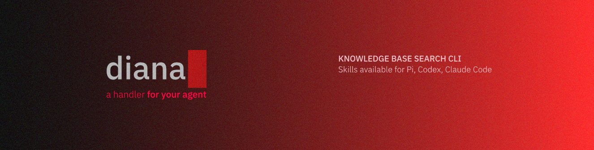

<div>
  
</div>

<div align="center">
  <p>&#8202;</p>
  <h1 align="center">diana</h1>
  <h4 align="center">A lightweight local Markdown search layer for agents</h4>
  <p>&#8202;</p>
</div>

### Search for relevant sections and read only what you need.

Backed by SQLite FTS5 and a selective indexing engine, Diana helps agents navigate large document collections with precision. It aims to reduce token usage and keep the context window uncluttered.

<p>&#8202;</p>

## Installation

Requires **Node.js >=22.13.0**.

```sh
npm install -g @koffeekat/diana
```

<p>&#8202;</p>

## Quick start

From your project root:

```sh
diana init
```

[Add a source](#adding-sources), then index it:

```sh
diana index
```

Run Diana from this same root. `diana index` refreshes every configured source.

> Quick hint: consider adding `diana index` as a pre-commit hook.

<p>&#8202;</p>

## Other CLI commands

| Command                                                     | What it does                                               |
| ----------------------------------------------------------- | ---------------------------------------------------------- |
| `diana search "token rotation"`                             | Find matching sections. Words are ANDed; results are JSON. |
| `diana read notes/architecture.md`                          | Read a note with limited output, returned as JSON.         |
| `diana read notes/architecture.md --section token-rotation` | Read one section using its search-result anchor.           |
| `diana --help`                                              | Show available commands.                                   |

Search-result `path` values are relative to `sourceRoot`; join both for an absolute read path. If a read returns `truncated: true`, request a narrower section where possible.

<p>&#8202;</p>

## Adding sources

Edit `diana.config.json` to share project sources:

```json
{
  "version": 1,
  "sources": [
    {
      "path": "notes",
      "include": ["**/*.md"],
      "exclude": ["drafts/**"]
    }
  ]
}
```

> The directory must already exist. Exclude patterns take priority. Use `exclude: []` when nothing should be excluded.

- **Project config — `diana.config.json`:** commit it so teammates share the same setup. Sources must stay inside the project.
- **Local config — `.diana/local.config.json`:** same format, for personal sources, including directories outside the project. Use an absolute path for an external source directory; `~` isn't expanded. Relative paths in either config start at the project root.

For example, `.diana/local.config.json` can point to a personal source directory:

```json
{
  "version": 1,
  "sources": [
    {
      "path": "/Users/you/Documents/personal-notes",
      "include": ["**/*.md"],
      "exclude": [],
      "autoReindex": true
    }
  ]
}
```

Replace the path with your source directory's absolute path, then run `diana index` once.

- `autoReindex` - refresh this source before each search. Useful for sources updated independently of your project. Defaults to false.

> 💡 Prefer pre-commit/post-merge hooks when commit-level freshness is enough. Use autoReindex when searches should also pick up uncommitted changes; it reads and hashes the source’s included files on every search.

**Keep the generated `.diana/.gitignore`.** It excludes your local config and index, helping prevent personal paths and cached note content from being committed. Git ignore rules aren't access controls; review both configs in unfamiliar projects. See [security and privacy](docs/security.md).

<p>&#8202;</p>

## Installing skills

Skills teach agents to search first and read only relevant sections. Install the CLI above first; your harness manages skill installation.

**Pi**

```sh
pi install npm:@koffeekat/diana
```

Reload with `/reload` if needed; invoke `/skill:diana`.

**Claude Code**

```text
/plugin marketplace add K0ffeeKat/diana
/plugin install diana@koffeeapps-diana
```

Invoke `/diana:diana`.

**Codex** — ask `$skill-installer`:

```text
Install skills/diana from the GitHub repository K0ffeeKat/diana.
```

Invoke `$diana` once available.

<p>&#8202;</p>

## Using Diana with Obsidian

Your vault can live inside the project:

```text
project/
├── diana.config.json        # source path: "notes"
├── .diana/                  # local config and index
└── notes/                   # open this folder as an Obsidian vault
    ├── .obsidian/           # skipped by Diana
    └── architecture.md
```

Keep editing in Obsidian as usual. Diana indexes the Markdown, skips hidden entries and symlinks, and leaves the vault unchanged. An external vault works through the local config instead.

<p>&#8202;</p>

## Troubleshooting

- **Command not found:** check the npm installation and your PATH. Installing a skill alone doesn't install the CLI.
- **No configuration:** run from the project root, where you ran `diana init`.
- **No sources/index, outdated schema, or stale results:** add a source if needed, check its patterns, and run `diana index`. Automatic refresh still needs an initial, compatible index.
- **Source outside project:** put it in the local config, not the project config.
- **Section not found:** reindex for current anchors; omit `--section` for headingless notes or pre-heading text.
- **File too large:** split notes larger than 1 MiB; requesting a section doesn't bypass this limit.

Removed sources disappear from cached results on the next successful search, even if no sources remain. To discard the cache entirely, stop Diana commands and delete only `.diana/index.sqlite`; preserve your local config.
